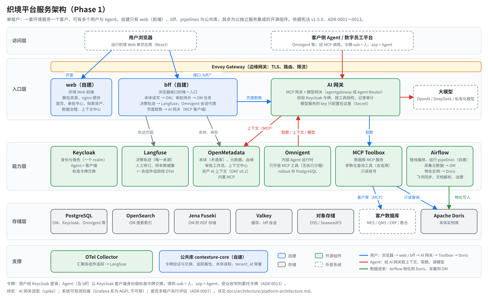
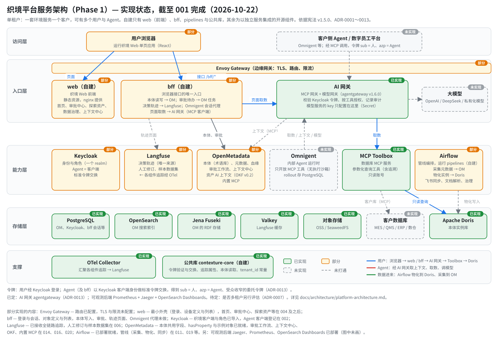
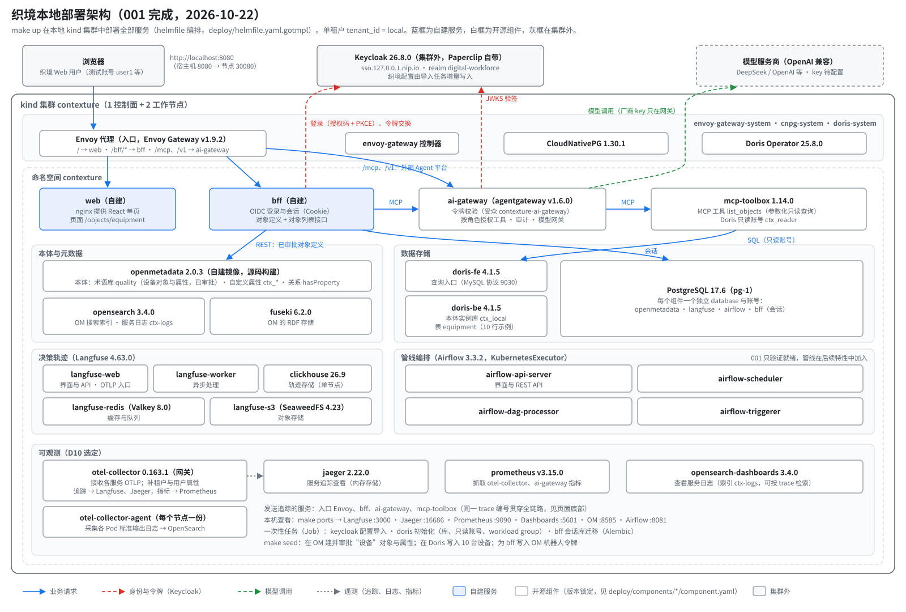

# 织境平台技术架构（Phase 1）

2026-10-08 · 依据：宪法 v1.5.0、ADR-0001 至 ADR-0013、`specs/001-engineering-foundation/`

## 1. 架构原则

1. **先把已有框架的能力用好**：OpenMetadata、Keycloak、Langfuse、Airflow、Omnigent、AI 网关、MCP Toolbox 以独立服务集成，按
   “配置 → 扩展 → 补丁”逐级定制（宪法 VI），不额外增加新的能力（ADR-0012）。
2. **只自建框架不具备的能力**：Phase 1 自建服务只有 `bff`（ADR-0013）。
3. **Agent 取数一律经 MCP**：经 AI 网关统一校验令牌、授权、路由与审计，数据库后端用 MCP Toolbox（ADR-0013）。
4. **审批只有一套**：统一使用 OM 治理工作流与任务。
5. **管线可由用户自定义与运维**：数据管线统一在 Airflow 中运行。
6. **架构保持最简**：不引入消息中间件、不建服务网格；Phase 1 只读，数据层授权推迟到二期（宪法 IV 例外）。

## 2. 总览



各服务的实现状态（绿：已实现，橙：部分实现，灰色虚线：未实现；生成脚本 `docs/images/平台服务架构-实现状态.gen.py`）：



当前（001 完成后）本地 kind 集群中实际部署的服务与调用关系见下图（生成脚本 `docs/images/本地部署架构.gen.py`）：



003 起，执行 `make mock-data` 后本地环境另有命名空间 `mock-sources`（模拟 MES：MySQL；模拟 QMS：PostgreSQL）与 Doris 中的 `mock_dw` 库（模拟数仓），
作为模拟的客户系统供开发与测试，不属于平台服务，也不进入交付物（见 `testdata/README.md`）。

文字版：

```text
访问层
  用户浏览器（运行织境 Web 单页应用）          客户数字员工平台 / 客户侧 Agent（Omnigent）
        │ OIDC + PKCE                              │ MCP（交换后的令牌）；OTLP / Webhook 回传轨迹
        ▼                                          ▼
边缘网关（Envoy Gateway）：页面 → web；/bff/* → bff；MCP 与模型 → AI 网关
        │                │                         │                                  │
        ▼                ▼                         ▼                                  ▼
  web（自建，      bff（自建）               AI 网关（MCP 网关 + 模型网关）       OTel Collector
  nginx 提供        ├─ 本体读写、审批 ──► OM    校验令牌、按工具授权、路由、审计          │
  静态资源）        ├─ 决策轨迹 ──► Langfuse ◄────────────────────────────────────────┘
                    ├─ Omnigent 会话代理       ├─► MCP Toolbox（只读账号）──► Doris 本体实例库、客户数据库
                    └─ 页面取数 ──► AI 网关    ├─► OM 内置 MCP
                                               ├─► 其他数据库 MCP 服务（按需）
                                               └─► 模型服务：OpenAI / DeepSeek / 私有化模型（key 只配在网关）

平台底座（第三方服务）
  OpenMetadata  本体（术语库）、元数据与血缘、治理工作流与任务、上下文中心、资产 AI 上下文（OKF v0.2，
                织境补丁）、内置 MCP；RDF 同步到 Fuseki
  Keycloak      身份、角色（一个 realm）；Agent 为客户端，标准令牌交换（sub = 人，azp = Agent）
  AI 网关       agentgateway（2026-10-19 spike 选定）：MCP 与模型流量的统一入口
  MCP Toolbox   数据库 MCP 服务：参数化查询工具与只读 SQL
  Langfuse      决策轨迹、人工修订、样本数据集
  Airflow       管线编排 ──► pipelines 任务镜像：OM 元数据采集、源系统接入与物化（直连 Doris 写入）、飞书同步
                （含修订写回 Langfuse）、文档解析、治理检查、生成 Doris 表结构
  Omnigent      内部 Agent 运行时（只开放 MCP 工具，Phase 1 不做执行沙箱）；上下文、取数与模型调用经 AI 网关
  存储与基础    PostgreSQL · OpenSearch · Fuseki · Valkey · 对象存储（OSS / SeaweedFS）
```

## 3. 自建部分

| 组件 | 职责 | 承载特性 | 独占存储 | 对外接口 | 主要依赖 |
| --- | --- | --- | --- | --- | --- |
| `web` | 织境 Web 前端（React 单页应用），打包为静态资源镜像，由 nginx 提供；Envoy 把页面请求路由到它（ADR-0003） | 004、013、022 等页面 | — | 静态资源（HTTP） | 浏览器内只调用 `bff` |
| `bff` | 浏览器唯一入口；本体读写；审批待办；轨迹页面；Omnigent 代理；页面取数（经 AI 网关） | 004、006（轨迹页面）、016（本体读写） | PostgreSQL `bff` database（会话） | REST + SSE（仅浏览器） | OM、Langfuse、Omnigent、AI 网关 |
| `pipelines`（镜像） | Airflow 任务 | 011、010、016、019、020、018 | 不独占（写入各自目标） | Airflow 任务 | Airflow、OM、Langfuse、Doris |
| 公共库 `contexture-core` | 令牌验证与上下文、令牌交换客户端、可观测关联属性、本体读取（`ontology`）、统一错误格式、配置 | 全部 | — | Python 库 | — |
| Paperclip 插件与下发 CLI | 轨迹回传 Langfuse；数字员工下发到 Paperclip | 007、008 | — | Paperclip 插件、CLI | Paperclip、Langfuse |
| 组件配置即代码（`deploy/components/<组件>/config/`） | Keycloak realm 与 Agent 客户端、AI 网关路由与策略、MCP Toolbox 工具定义（含追溯查询模板）、OM 初始化；各带测试 | 002、005、016、021 | — | 配置文件 | — |
| `metric`、`explore`（P2） | 指标生成 SQL；探索与固化 | 012、024、025、026 | 二期确定 | REST / MCP | OM、AI 网关 |

**复用框架、不建服务的特性**：002 身份（Keycloak + 配置即代码）；005 数据访问与审计（AI 网关 + MCP Toolbox；数据层授权推迟）；
009 内部 Agent 运行时（Omnigent）；006 决策轨迹（Langfuse）；011 / 010 / 019 接入（Airflow + OM 采集框架）；016 本体与分级标签
（OM 术语库与分类标签）；017 质量领域包（本体内容）；021 追溯（Toolbox 参数化查询工具）；018 / 014 上下文（OM 上下文中心、
资产 AI 上下文、MCP，OKF v0.2 补丁）；023 / 015 参考 Skill。

## 4. 第三方组件（开源服务清单，宪法 III）

版本为初定版本（2026-10-17），在各组件的 `component.yaml` 中锁定；与 OpenMetadata 2.0.3 有依赖关系的组件以 OM 支持的版本为准。

| 组件 | 版本 | 许可 | 用途 | 部署单元 / 所在位置 | 集成方式 | 可替换方案 |
| --- | --- | --- | --- | --- | --- | --- |
| OpenMetadata | 2.0.3（自建镜像 `2.0.3-ctx.N`） | 服务端 Apache 2.0；采集框架与内置 MCP 为 CCL（已批准例外，私有化交付可用）；界面仅内部使用 | 本体、元数据、血缘、审批、上下文 | `openmetadata-server`、迁移任务；采集任务由 Airflow 拉起 | 从织境维护的 OM 仓库构建；Phase 1 补丁仅 OKF v0.2（ADR-0011、0012） | DataHub |
| Keycloak | 26.8.0（外部实例须 ≥ 26.2） | Apache 2.0 | 身份、角色、标准令牌交换 | 默认接入客户已有 Keycloak（本机与 Paperclip 共用）；开关 `keycloak.enabled` 打开时随织境部署 | keycloak-config-cli 增量导入织境的客户端与角色；客户 IdP 可接入自带 Keycloak | Zitadel、Authentik |
| AI 网关 | agentgateway v1.6.0（spike 选定；Agent Router 1.2.0 为备选） | Apache 2.0 | MCP 网关 + 模型网关、审计 | `ai-gateway` | 配置（路由、令牌校验、CEL 授权、审计） | 自建薄网关（ADR-0013 后备） |
| MCP Toolbox | 1.14.0 | Apache 2.0 | 数据库 MCP 服务 | `toolbox`（一个实例） | 配置（数据源与工具定义） | Apache Doris MCP Server |
| Langfuse | 4.63.0 | MIT（不启用 `ee` 功能） | 决策轨迹 | `langfuse-web`、`langfuse-worker`；依赖 ClickHouse 26.9（本地 / 测试为单节点）、Valkey 8.0、SeaweedFS 4.23（测试环境用 OSS） | 配置 | 自建 |
| OTel Collector | 0.163.1 | Apache 2.0 | 追踪汇聚 | 网关模式，开启持久化队列 | 配置 | 各组件直连后端 |
| Doris | 4.1.5（Operator 25.8.0） | Apache 2.0 | 本体实例库 | FE、BE | 配置 | StarRocks |
| Apache Airflow | 3.3.2 | Apache 2.0 | 管线编排 | scheduler、api-server、dag-processor、triggerer；任务 Pod | 配置 + DAG | Argo Workflows |
| Omnigent | v0.18.0（`ctx/v0.18.0`） | Apache 2.0 | 内部 Agent 运行时 | `omnigent-server`、runner、host（普通 Pod，只开放 MCP 工具） | 从织境维护的仓库构建；补丁 + 扩展（ADR-0002） | Pydantic AI（需自建会话与界面） |
| Paperclip | 使用方部署的版本 | MIT | 数字员工平台（最终用户） | 使用方部署，织境经 MCP 接入 | 配置 + 织境插件（ADR-0010） | 其他支持远程 MCP 的平台 |
| Envoy Gateway | 1.9.2 | Apache 2.0 | 边缘网关 | 控制器 + Envoy 代理 | 配置（页面 → `web`，`/bff/*` → `bff`，MCP 与模型 → AI 网关） | Kubernetes Gateway API 的其他实现 |
| nginx | 1.31.7 | BSD-2-Clause | `web` 静态资源 | `web` 镜像内 | 配置 | Caddy |
| PostgreSQL | 17.6（CloudNativePG 1.30.1） | PostgreSQL License / Apache 2.0 | 各组件数据库 | 高可用集群 | 每个组件一个独立 database | MySQL（OM 支持） |
| OpenSearch | 3.4.0（与 OM 2.0.3 上游开发环境一致） | Apache 2.0 | OM 索引、服务日志 | 集群 | 配置 | — |
| Jena Fuseki | 6.2.0（从 OM 子仓库 `docker/rdf-store` 构建） | Apache 2.0 | OM 的 RDF 存储 | 服务器 | 配置 | 不启用 OM 的 RDF |
| 对象存储 | 测试环境 OSS；本地与离线 SeaweedFS 4.23（Langfuse Chart 自带） | Apache 2.0 | 文件与 Langfuse 存储 | — | S3 兼容接口 | MinIO（AGPL，不选） |
| 可观测后端 | Prometheus v3.15.0、Jaeger 2.22.0（内存存储）、OpenSearch Dashboards 3.4.0；日志由 OTel Collector 节点代理采集写入 OpenSearch（索引 `ctx-logs`） | Apache 2.0 | 服务指标、追踪、日志查看 | 组件 `prometheus`、`jaeger`、`opensearch-dashboards`、`otel-collector`（节点代理） | 配置 | Grafana 系（AGPL，不选） |
| JupyterHub（P2） | 在 025 中锁定 | BSD | Notebook 工作台 | hub、proxy；用户 Pod | 配置 + 扩展 | — |

**统一管理**：每个组件在 `deploy/components/<组件>/` 有标准目录：清单 `component.yaml`（版本、镜像来源、许可、
定制级别、负责人）、Chart、各环境参数、配置即代码与测试；CI 检查清单完整、版本锁定、许可合规、镜像进入离线包
（ADR-0009）。

部署编排：helmfile 1.8.2（MIT，开发与交付工具，不进集群）汇总上表组件的 Chart 与参数（`deploy/helmfile.yaml.gotmpl`）；
各组件的版本、镜像与许可以 `deploy/components/*/component.yaml` 为准，`make components-check` 校验，二者须与本表一致。

## 5. 数据归属

| 数据 | 正本存放 |
| --- | --- |
| 本体（对象、关系、属性、映射）、元数据与血缘、指标、分类标签、治理工作流与任务、文章 / 文件 / 记忆 | OpenMetadata |
| 本体实例（对象实例、关系实例） | Doris 本体实例库 |
| 取数审计 | AI 网关日志（经 OTel 汇聚）；Doris `audit_log` 补充 SQL 与行数，按 trace_id 关联 |
| 决策轨迹、人工修订、样本 | Langfuse |
| Agent 运行状态（rollout） | PostgreSQL `omnigent`（ADR-0001、0002） |
| 身份、角色、Agent 身份 | Keycloak（Agent 为客户端）；Agent 登记文件在 `agents/<名称>/registration.yaml`，同步到 Keycloak |
| 客户分析数据 | 客户数仓（织境不复制） |

## 6. 关键链路

| 链路 | 路径 |
| --- | --- |
| 用户查询实例 | `web` → `bff`（MCP 客户端，交换令牌）→ AI 网关 → MCP Toolbox → Doris；本体定义经公共库 `ontology` 从 OM 读取 |
| Agent 取上下文 | Agent → AI 网关 → OM 内置 MCP / 资产 AI 上下文（OKF v0.2） |
| Agent 查实例与客户数据 | Agent（交换令牌：sub = 人，azp = Agent）→ AI 网关 → MCP Toolbox / 其他数据库 MCP → 数据库 |
| Agent 调模型 | Omnigent → AI 网关（模型网关）→ 模型 |
| 本体维护 | `web` → `bff` → OM 术语（OM 审批）→ 管线任务生成 Doris 表结构；OM 同步 RDF 到 Fuseki |
| 数据接入 | Airflow → `pipelines`：OM 元数据采集；源系统按本体映射物化到 Doris（直连写入）；飞书定时同步 |
| 决策轨迹 | 各服务、AI 网关与外部平台 → OTel Collector → Langfuse；人工修订由飞书同步管线写回 Langfuse；`bff` 读取展示 |
| 审批 | OM 治理工作流生成任务 → `bff` 展示于审批中心 → 处理结果回写 OM |

## 7. 跨切面机制

| 机制 | 做法 |
| --- | --- |
| 通信 | 浏览器经 `bff`（REST + OpenAPI 3.1）；Agent 取数与取上下文经 MCP；无消息中间件；批处理由 Airflow 编排 |
| 模型接入 | 模型服务（OpenAI、DeepSeek、私有化模型）只在 AI 网关中配置：服务商地址、模型名、key（K8s Secret / KMS）、路由与配额；按人与 Agent 的模型权限和 token 配额用网关自带能力实现（与 LiteLLM 基本对齐，不额外开发）；用量看 Langfuse；Omnigent 以“OpenAI 兼容网关”方式连接 AI 网关，用委托令牌认证，不持有任何厂商 key（ADR-0013） |
| 用户与界面 | 最终用户（业务人员）在 Paperclip 中与数字员工对话；数据处理与治理人员使用织境 Web（重做的 OM 界面，对话能力复用并改造 Omnigent 前端）；默认角色：管理员、AI 工程师、业务用户；织境与 Paperclip 共用同一个 Keycloak realm（ADR-0003、0010） |
| 数字员工平台 | Phase 1 选定 Paperclip（Keycloak 单点登录）：经 MCP 连接 AI 网关；织境以下发 CLI 把数字员工推送到 Paperclip（007）；默认权限按 Keycloak 角色，工具清单写入 Paperclip 工具策略；完整轨迹经 Paperclip 插件回传 Langfuse（008） |
| 外部 Agent 接入 | 不绑定外部框架；客户自建平台经标准 MCP 接入 AI 网关（MCP 授权规范，Keycloak 作授权服务器）；身份分三档：A 每个 Agent 一个客户端、B 平台作为一个客户端（平台内 Agent 为声明属性，注明未验证）、C 服务账号；网关侧必记轨迹，平台侧可选回传（ADR-0010） |
| 令牌 | Keycloak 登录；Agent 以客户端身份做标准令牌交换（sub = 人，azp = Agent，受众收窄）；无人值守 Agent 用服务账号 |
| 授权 | Phase 1 只到身份、角色与工具一级（AI 网关 CEL 规则）；数据层授权推迟到二期（宪法 IV 例外） |
| 审计 | AI 网关记录每次 MCP 调用；OM 自身记录写操作审计 |
| 租户 | Phase 1 单租户：一套环境只服务一个客户，可有多个用户与 Agent；`tenant_id` 作为部署常量写入审计、追踪与日志；多租户设计见 ADR-0007（暂缓，是否采用另行评估） |
| 可观测 | 公共库注入关联属性（`contracts/otel/attributes.md`），trace 经 MCP `_meta` 传播，经 OTel Collector 汇聚 |

## 8. 待决事项

已决（001，2026-10-19）：
- **AI 网关**：agentgateway v1.6.0（spike 记录 `docs/research/ai-gateway-spike/README.md`，ADR-0013）。
- **系统可观测后端**：追踪 Jaeger（另送 Langfuse 作决策轨迹）；指标 Prometheus（抓取 OTel Collector 汇总的 OTLP 指标与
  AI 网关自带指标）；日志由 OTel Collector 节点代理采集各 Pod 标准输出写入 OpenSearch，用 OpenSearch Dashboards 查看。
  本地已验证：一次请求的 bff、AI 网关、Toolbox 追踪在 Jaeger 可查；Prometheus 抓取目标均为 up；日志按 trace_id 可检索。
  测试环境的持久化（Jaeger 存储后端、Prometheus 保留期）在 004 之后的阿里云测试环境中确定。

| # | 事项 | 说明 |
| --- | --- | --- |
| 2 | OKF v0.2 补丁是否提交上游 | 待定（ADR-0012） |
| 3 | Doris 表结构迁移的评审方式 | 管线按本体生成的迁移以 PR 评审还是以 OM 任务审批 |
| 5 | 需验证 | OM MCP 能否接受交换后的令牌（014）；Omnigent 以委托令牌作网关凭证并续期（009）；资产 AI 上下文是否包含未审批内容 |
| 6 | 二期 | 数据层授权方向；BI 与 Notebook 的原生 SQL 通道 |
| 7 | 是否多租户 | Phase 1 单租户；是否支持多客户共享实例另行评估，不预设在二期（ADR-0007） |
